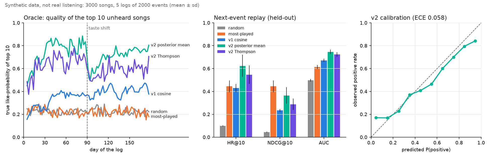

# music-connector

A personal music recommender that runs on your Mac. Full songs are embedded with
[MuQ-MuLan](https://huggingface.co/OpenMuQ/MuQ-MuLan-large) and stored in Postgres + pgvector.
Playlists are built from your taste clusters plus exploration slots for indie, older and random music.

**Status: v2 + live capture.** Embeds local files, and also songs while you listen in Brave
(YouTube Music / YouTube). Imports Google Takeout history and builds playlists in the terminal,
scored by a Thompson-sampling preference model once there is enough feedback (see
[v2](#v2-thompson-sampling-preference-model)). Also analyses songs for the visual music player:
beats, energy, sections and audio descriptors, as a versioned JSON contract
([analysis sidecar](#analysis-sidecar-songanalysis-v1)).

## Live capture in Brave

1. Start the server: `uv run mc serve` (listens on `ws://127.0.0.1:8765`, loads the model once).
2. Go to `brave://extensions`, turn on **Developer mode**, click **Load unpacked**, and choose
   the `extension/` folder. Pin the "Music Connector" icon.
3. Open music.youtube.com (or a music video on youtube.com) and **click the icon**. The badge
   shows `ON` when audio is streaming to the server, and `…` while it waits for `mc serve`.
   Click again to stop. You need to click once per tab after each browser restart, because
   Chrome only allows tab capture after an explicit click.

What happens while you listen:

- The tab's audio is cut into 10 s windows and embedded as you listen. No audio is written to
  disk. When a track ends, the song vector, its window vectors and the fraction of the song you
  heard are saved. If you listen again and hear more of it, the vector is replaced.
- Listen events: **complete** (≥ 80% heard or reached the end; a repeat also logs **replay**),
  **skip** (moved on before 30 s), **play** (anything in between). 👍/👎 clicks in the player
  are logged as **like**/**dislike**.
- Pauses, buffering, seeks and ads are excluded, and so are silent windows. YouTube's volume
  slider and loudness normalisation are undone, so live and file embeddings match: a live
  capture at 50% volume scored 0.9999 cosine against the same file.
- youtube.com is captured only when you click the icon on that tab, because most of YouTube
  isn't music.

`scripts/simulate_extension.py` replays local files through the same protocol to test the
server without a browser.

Limits: only listening in Brave on this Mac is captured, not on your phone. The like-button
selectors depend on YouTube's current page markup and may need updating when it changes. Up to
~0.1 s of the previous song can leak into the first window of the next.

## Setup

Requires macOS or Linux with Docker, [uv](https://docs.astral.sh/uv/) and ffmpeg
(`brew install uv ffmpeg`). uv installs Python 3.12 itself if needed. The model runs on Apple
Silicon (MPS), CUDA or CPU; the timings below are for an M3 Pro.

```sh
git clone <repo-url> music-connector && cd music-connector
cp .env.example .env          # optional: change MC_DB_PORT if 5433 is taken
docker compose up -d --wait   # Postgres 17 + pgvector on localhost:5433; creates the schema
uv sync
uv run mc songs               # checks the database connection: "Embedded songs (0 of 0)"
uv run mc bench               # MuQ-MuLan speed on this machine (downloads ~2.5 GB of weights once)
```

Every setting has a default, so `.env` is optional. docker compose reads it automatically; to
point `mc` at a different port or database, export the variables or run
`uv run --env-file .env mc ...`. See `.env.example` for the list.

Tests need neither the model nor the database:

```sh
uv run pytest
uv run ruff check . && uv run ruff format --check .
```

## Usage

```sh
uv run mc ingest ~/Music/some-album --pool indie       # embed full audio files
uv run mc import-takeout ~/Downloads/watch-history.json
uv run mc songs
uv run mc rate "Somebody Else" like                    # like | dislike | skip | complete | replay
uv run mc similar "Somebody Else"
uv run mc search "dark slow R&B with heavy reverb"     # describe a sound in words
uv run mc taste                                        # your taste clusters
uv run mc recommend --size 25                          # --seed N fixes the Thompson draw
uv run mc serve                                        # live capture + the /analyze API
uv run mc analyze song.mp3 -o song.analysis.json       # SongAnalysis v1 for the visual player
```

`--pool` tags songs for the playlist's exploration slots: `indie`, `classic` (older decades), `new`.

## Analysis sidecar (SongAnalysis v1)

The visual music player needs to know where the beats, the sections and the repeats are, and
roughly what a song sounds like. `mc analyze` and `mc serve`'s `/analyze` produce that as a
`SongAnalysis` JSON file. The contract is owned by this repo: Pydantic models in
`src/music_connector/analysis/schema.py`, exported as JSON Schema to
[`schema/song-analysis.v1.schema.json`](schema/song-analysis.v1.schema.json)
(`uv run mc schema -o schema/song-analysis.v1.schema.json`; a test fails if it is stale).

```
visual music player                                   music-connector (this repo, Mac only)
 ├─ on track load ── POST /analyze (bytes or path) ─►  mc serve on 127.0.0.1:8765
 │                                                      ├─ ffmpeg → 24 kHz mono
 │                                                      ├─ librosa: tempo, beats, downbeats,
 │                                                      │  onsets, RMS + 3 bands at 10 Hz
 │                                                      ├─ MuQ-MuLan: 10 s windows, 5 s hop
 │                                                      ├─ novelty → boundaries on downbeats,
 │                                                      │  window embeddings → A / B / A′ labels
 │  ◄────────────── SongAnalysis JSON ─────────────────┤  calibrated text descriptors
 └─ no server? load <song>.analysis.json               └─ cache: ~/.cache/music-connector/analysis
    (examples/ has three for the hosted demo)              keyed by SHA-256 of the audio bytes
```

```sh
uv run mc analyze song.mp3                       # writes song.analysis.json beside it
uv run mc analyze song.mp3 -o - --pretty         # to stdout
uv run mc analyze song.mp3 --windows --nearest 5 # + per-window descriptors, 5 closest library songs

uv run mc serve                                  # then, from the player or a script:
curl -X POST 'http://127.0.0.1:8765/analyze?name=song.mp3' -H 'Content-Type: audio/mpeg' --data-binary @song.mp3
curl -X POST http://127.0.0.1:8765/analyze -H 'Content-Type: application/json' -d '{"path": "/Users/me/Music/song.mp3"}'
curl 'http://127.0.0.1:8765/analyze?path=/Users/me/Music/song.mp3&windows=1'
curl http://127.0.0.1:8765/health                # {"ok": true, "schemaVersion": "1.0", ...}
```

Options (query string, or JSON body fields): `windows=1`, `nearest=N`, `refresh=1` (ignore the
cache), `name=` (file name recorded for byte uploads). Errors are JSON `{"error": ...}`: 400 bad
request, 403 forbidden origin or host, 404 no such file, 422 audio that won't decode.

**Who can call it.** The server binds to 127.0.0.1. `/analyze` and `/health` accept requests with
no `Origin` (curl, scripts) or from the player's dev server, `http://localhost:5173` and
`http://127.0.0.1:5173`, with CORS headers for those origins only. Add more with
`MC_ALLOWED_ORIGINS=http://localhost:4173,...`. Requests whose `Host` isn't localhost are refused
(DNS-rebinding guard). The WebSocket at `/` still takes only the extension or local scripts, as
before. A path request may name any audio file the server can read; the response contains the
analysis, never the audio.

### What's in the file

| Field | What | Source |
|---|---|---|
| `schemaVersion` | `"1.0"`. Minor versions only add optional fields; readers must ignore unknown fields. A breaking change gets a new major version and schema file. | |
| `source` | `sha256` of the file bytes (the cache key), base `fileName`, `durationS`, `sampleRate` | |
| `tempo` | `bpm`, `confidence` (onset autocorrelation at the beat period; below ~0.45 the tempo may be 2× off), `beatsPerBar` (always 4 in v1) | librosa |
| `beats`, `downbeats`, `onsets` | times in seconds | librosa; downbeat phase from bass onsets + chord changes |
| `energy` | `frameRate` (10 Hz), `rms`, `low` (20–250 Hz), `mid` (250–4k), `high` (4–12k), each 0..1 within the song over a 48 dB range; `loudnessDb` for the absolute level | STFT |
| `segments[]` | `start`, `end`, `label` (`A`, `B`, `A′`), `group` (`A`), `variant` (1 = ′), `similarity` to the group's first occurrence, `boundaryStrength`, mean `energy`, top-2 `descriptors` per axis | novelty + MuLan |
| `descriptors` | per axis (`genre`, `mood`, `instruments`, `vocals`, `texture`): top-3 `{label, cos, z}` | MuLan text prompts, calibrated |
| `windows` | only with `windows=1`: start times and top-1 descriptors per 10 s window | MuLan |
| `nearest` | only with `nearest=N`: closest songs in your library (`songId`, `title`, `artist`, `cosine`) | pgvector |

Tempo, energy and era are deliberately not MuLan descriptors: zero-shot prompts got all three
wrong on the first probe song, and DSP measures the first two directly. A 4½-minute song is
~85 KB of JSON (~25 KB gzipped); most of it is the 10 Hz energy curves and onsets.

**Descriptor calibration.** Raw prompt cosines carry per-prompt bias ("male vocals" scores high on
everything). `z` subtracts each prompt's mean on a reference corpus, shrunk 75% towards the
axis mean, and divides by the axis's spread. The packaged calibration (`cc-reference-79`) comes
from 79 CC tracks, none of them in the quality check below. `mc calibrate --from-db` recalibrates
against your own library's stored embeddings (written to `~/.config/music-connector/`, read-only
on the database); `mc calibrate <folder>` against any audio folder.

**Cost** (M3 Pro, measured): DSP 0.3–1 s and MuLan 5.5–7.5 s per song (twice the windows of
`mc ingest` because of the 5 s hop), so ~7 s for a new song; a cached repeat returns in ~5 ms.
`mc serve` loads the model at start-up (10–16 s); `mc analyze` loads it per run.

### Analysis quality (28 songs)

Measured with `scripts/eval_analysis.py` on audio kept outside the repo (see "Eval audio" below).
Nothing here was tuned on these songs: segmentation settings and the descriptor shrinkage were
chosen on a separate 79-track set (25 SALAMI-annotated live recordings for segmentation,
54 tagged ccMixter tracks for descriptors).

| What | Truth | Result | For scale |
|---|---|---|---|
| Section boundaries, 13 songs | SALAMI human annotations (12 live recordings), my own LRC-based marks for Sunflower | **F 0.63** at ±3 s (best of the two annotators) | annotators vs each other 0.82; a boundary every 20 s scores 0.29 |
| Repeat labels, same 13 songs | same | **pairwise F 0.66** | annotators vs each other 0.70 |
| Tempo, 13 ccMixter songs with a BPM tag | uploader's BPM | **8 within 4%**, 3 off by 2× (or ⅔), 2 wrong | |
| Genre, 15 ccMixter songs | uploader tags | top-1 **9/15**, top-3 12/15 (raw cosine: 8/15, 12/15) | 24 genre prompts |
| Instruments, 11 songs | uploader tags | top-1 **8/11**, top-3 9/11 (raw: 7/11, 9/11) | 19 prompts |
| Vocals, 12 songs | uploader tags | top-1 **9/12**, top-3 11/12 (raw: 6/12, 11/12) | 6 prompts |
| "Live recording" texture, 12 live songs | they are all live | top-1 **7/12**, top-3 12/12 (raw: 8/12, 12/12) | 6 prompts |

The misses, honestly:
- **Over-segmentation.** It finds phrase-level changes humans don't mark as sections: 21
  segments against 12 on one long jam (Brownfish, F 0.52), 17 against 8 on a string-band tune.
  Repeated material then shows up as runs of the same label (`CCCC`), which a consumer can merge.
- **Verse and chorus can share a letter.** On Sunflower the boundaries are right (F 0.86) but the
  first chorus gets the verse's letter and the second chorus the pre-chorus's (`ABCDCCCD′`
  against `ABCDECDF`), so pairwise F is only 0.44. The plan's earlier probe already saw verse vs
  chorus at ~0.91 against ~0.96 for chorus vs chorus; one similarity threshold can't separate
  that in every song.
- **Tempo octave errors** on a piano improvisation, a slow latin track and a 73 BPM folk song
  (all reported at ~2×); two dance tracks were wrong outright (70 and 104 against 134 and 130).
  `tempo.confidence` is a weak warning: it was ≤ 0.32 on two of these five and ≥ 0.45 on every
  correct one.
- **Downbeats are unverified**: there is no downbeat truth in this set. The phase heuristic
  assumes 4/4.
- **Descriptors are hints.** A cello-and-marimba ambient piece comes out "orchestral film score",
  a jazz song "gospel", a reggae song "funk", and the woman singing *Unbury Your Heart* is
  "male vocals" (female second). Two instrumentals get "choir" or "rap vocals". Full per-prompt
  z-scoring, the original plan, did *worse* than raw cosines on both sets (it inflates prompts
  with a narrow spread, like "choir"), hence the 25% shrinkage.
- The truth is thin: 15 tagged songs, uploader tags are incomplete, and the live recordings are
  mostly rock/jam bands. Treat these numbers as indicative.

### Eval audio and examples

The audio lives in `~/music-connector-eval-audio` (never in the repo); its `README.md` lists every
file with its source and licence: 15 CC BY ccMixter tracks, 12 Live Music Archive recordings from
the SALAMI dataset (non-commercial sharing; no CC licence stated, used locally only), the owner's
Sunflower test file, and the 79-track `calibration/` set. Re-run the check with:

```sh
uv run python scripts/eval_analysis.py features ~/music-connector-eval-audio              # model, ~4 min
uv run python scripts/eval_analysis.py features ~/music-connector-eval-audio/calibration
uv run python scripts/eval_analysis.py report ~/music-connector-eval-audio                # no model
uv run python scripts/eval_analysis.py tune ~/music-connector-eval-audio/calibration      # segmentation grid
```

[`examples/`](examples/) has precomputed analyses of three CC BY songs with published lyrics, for
the player's hosted demo, and [`examples/ATTRIBUTION.md`](examples/ATTRIBUTION.md) with credits and
download links. The audio itself is not included.

## Performance (M3 Pro, 18 GB, measured)

| | |
|---|---|
| Model load | ~10–16 s (663M parameters, on the GPU via MPS) |
| Decode (ffmpeg → 24 kHz mono) | ~0.3 s per song |
| Embedding | ~0.14 s per 10 s window, **~70× faster than real time** (a 4-minute song takes ~3.5 s) |
| 5,000 songs × 3.5 min | **~4 h** embedding + ~0.3 h decoding |
| GPU memory | up to ~9 GiB at batch size 16; batch 1 is just as fast and is the default |

Notes:
- **fp16 is unusable on MPS**: autocast gives NaN embeddings, so the model runs in fp32.
- **`transformers` is pinned below 4.50**: `muq` 0.1.0 breaks with newer releases
  (`'EasyDict' object has no attribute '_attn_implementation'`).
- `mc ingest` stops macOS idle sleep while it runs. Closing the lid on battery still
  suspends it; earlier runs took hours because of that, not because of the pipeline.
- Re-uploads of the same recording score ~0.998 cosine. The playlist builder treats anything
  above 0.97 as a duplicate.

### Google Takeout

At takeout.google.com, select only **YouTube and YouTube Music → history**, and set the format to
**JSON**. Plays of songs that haven't been embedded yet are kept. They start counting towards your
taste once their audio is embedded.

## How recommendations work

1. **Embedding:** every song is cut into 10 s windows at 24 kHz, and each window becomes a 512-d
   MuQ-MuLan vector. The song vector is their re-normalised mean. `embedding_spread` records how
   much the windows differ: low means a consistent song, high means very different sections.
   Window vectors are kept in `song_windows`.
2. **Taste:** each event (like 1.0, replay 0.6, complete 0.3, play 0.1, skip −0.7, dislike −1.0)
   is weighted by recency, with a 90-day half-life. Songs with positive totals are grouped by Ward
   clustering, and each cluster is represented by its weighted medoid (PinnerSage, KDD 2020).
3. **Playlist:** slots are split 55% taste (shared across clusters by importance), 20% indie,
   15% classic and 10% wildcard. Slots a pool can't fill go back to taste. Candidates are the
   pgvector nearest neighbours of each medoid. With fewer than 50 feedback events their score is
   v1's similarity to the medoid, with a penalty for closeness to disliked songs; from 50 on it is
   the v2 model below. MMR then selects for diversity, with at most 2 songs per artist, and songs
   within 0.97 cosine of anything already heard or picked are dropped. Finally the playlist is
   ordered so each song leads to its closest neighbour.

Settings are in `src/music_connector/config.py`.

## v2: Thompson-sampling preference model

Cosine-to-medoid knows *which* region of sound you like, but not *what within it*: two songs
equally close to a medoid score the same even if you always finish one kind and skip the other.
v2 learns that from your feedback, and keeps exploring where it is unsure.

**Model** (`src/music_connector/preference.py`):

1. **Projection.** PCA fit on the whole library's embeddings (unsupervised, so it never sees
   feedback), keeping 16 components scaled to unit variance, plus a bias term. 512 → 17 numbers
   keeps the posterior small enough to be well determined by a few hundred events.
2. **Reward.** Each event becomes a target and a weight: like 1 (weight 1), complete 1 (0.5),
   replay 1 (0.6), dislike 0 (1), skip 0 (0.7), play 0.5 (0.3). The events table stores no
   per-event listen fraction, but the live capture's kinds are fraction bands (skip < 30 s,
   play 30 s–80 %, complete ≥ 80 %), so a play counts as half. Weights decay with the same
   90-day half-life as v1.
3. **Posterior per taste cluster.** Conjugate Bayesian linear regression on the target scaled to
   [−1, 1]. A global posterior is fit on all events; each PinnerSage cluster then starts from the
   global mean (partial pooling) and adds the events whose song is nearest its medoid. A cluster
   with few events stays close to the global fit instead of guessing.
4. **Thompson sampling.** Each `mc recommend` draws one weight vector per cluster from its
   posterior and scores every candidate with the draw for its nearest cluster. Uncertain clusters
   vary more between playlists, which is the exploration. The draw is scaled by 0.5, a common
   tempering (Chapelle & Li, 2011); `--seed` makes it reproducible.
5. **On top, unchanged from v1:** cluster retrieval, slot quotas, the duplicate guard, MMR
   diversity, the artist cap and smooth ordering.

Below 50 feedback events on embedded songs the posterior is mostly prior, so `mc recommend` uses
v1 and says which model it used in the table title.

### Offline replay eval

`scripts/replay_eval.py` replays an events log in time order. Every 25 events each method is fit
on the past only, then scores the next events:

- **HR@10 / NDCG@10:** each held-out like/complete/replay ranked against 99 songs not yet heard.
  Sampled negatives flatter every method equally; use them to compare methods, not as absolute
  quality.
- **AUC:** score of held-out positives (like, complete, replay) vs negatives (skip, dislike).
- **Calibration:** Brier and expected calibration error for methods that output a probability.
- **Oracle like-rate@10** (synthetic only): the true like-probability of each method's top 10
  unheard songs, i.e. what a playlist would actually deliver.

Baselines: **random**, **most-played** (v1's recency-weighted event total per song: single-user
popularity), **v1 cosine**, and v2 both as the **posterior mean** and as one **Thompson** draw.



**Results on synthetic data** (not real listening data; 3,000 songs, 5 logs of 2,000 events,
mean ± sd over logs; full numbers in `docs/replay-eval.json`):

| | HR@10 | NDCG@10 | AUC | Brier | ECE | Oracle like-rate@10 |
|---|---|---|---|---|---|---|
| random | 0.10 ± 0.00 | 0.04 ± 0.00 | 0.50 ± 0.01 | 0.248 | 0.048 | 0.22 ± 0.00 |
| most-played | 0.44 ± 0.05 | 0.44 ± 0.05 | 0.61 ± 0.02 | 0.248 | 0.048 | 0.22 ± 0.01 |
| v1 cosine | 0.43 ± 0.04 | 0.23 ± 0.01 | 0.67 ± 0.01 | – | – | 0.36 ± 0.03 |
| v2 posterior mean | **0.62 ± 0.10** | 0.36 ± 0.07 | **0.75 ± 0.02** | **0.205** | 0.058 | **0.73 ± 0.03** |
| v2 Thompson | 0.55 ± 0.08 | 0.29 ± 0.05 | 0.72 ± 0.02 | – | – | 0.61 ± 0.02 |

How to read it:

- v2 doubles the true like-rate of the top 10 over v1 (0.73 vs 0.36) and recovers after the
  simulated taste shift on day 90. v1 can't separate songs that are equally close to a medoid.
- Most-played wins NDCG because many held-out positives are replays of songs it already ranks
  first; it has nothing to say about unheard songs (oracle 0.22, the same as random).
- The Thompson draw scores below the posterior mean offline. That is expected: a replay of a fixed
  log can only charge for exploration, never pay it back, because the songs a draw would explore
  were never shown. The online benefit of Thompson sampling is not measurable this way.
- Calibration is fair (ECE 0.06); a linear model on a bounded reward over-predicts at the
  extremes, visible in the reliability panel.
- `random` and `most-played` report the running base rate as their probability, which is why
  their Brier and ECE are identical.

**Why synthetic.** The owner's own log is far too small to replay: at the time of writing it has
41 embedded songs and 3 feedback events, below the 50-event warm-up, so the script reports "too
few events" rather than metrics. No public listening dataset ships MuQ-MuLan embeddings, and
computing them needs the audio and the non-commercial model. `src/music_connector/synthetic.py`
instead builds a library with the same geometry as a real MuQ-MuLan library (unit vectors, a
strong shared component; pairwise cosine 0.34 ± 0.19 vs 0.42 ± 0.19 measured in aggregate on a
real one) from genres, sub-genres and continuous style axes. Its listener likes a few sub-genres,
prefers one end of a style axis within each, shifts taste halfway through, and is served by a
logging policy like real use (mostly neighbours of liked songs, some replays, some random). The
v2 settings were chosen on a different synthetic world and log seed from the ones reported.

```sh
uv run python scripts/replay_eval.py synthetic   # regenerates docs/replay-eval.{png,json}
uv run python scripts/replay_eval.py owner       # your events table, read-only, prints aggregates
```

**Privacy.** The eval runs locally. The `owner` mode opens a read-only transaction, writes
nothing to the database or the repo, and prints only counts and aggregate metrics: never song
ids, titles or events. The committed plot and JSON come from synthetic data only.

## Privacy

Everything stays on your machine. Audio is decoded in memory and never written to disk, with
one exception: an M4A/MP4 uploaded to `/analyze` whose index sits at the end of the file can't be
decoded from a pipe, so it goes through a private temp file that is deleted straight away. Your
listening history, ratings and embeddings live only in the local Postgres volume. The server
binds to 127.0.0.1; live capture accepts only the extension or local scripts, and `/analyze`
only local scripts and the player's dev origin. Analyses are cached under
`~/.cache/music-connector/analysis`; they hold no audio, and library song titles only if you ask
for `nearest`. The v2
preference model is refit in memory from the local events table on each `mc recommend` and is
never saved or sent. Nothing is sent anywhere except the one-time model download from Hugging Face.

This repository contains no listening data: no Takeout exports, no event history, no audio. The
`.gitignore` excludes `.env`, `watch-history*.json`, Takeout folders, audio files and local data
directories so they can't be committed by accident.

## Licences

The code is MIT-licensed (see `LICENSE`). The MuQ-MuLan weights it downloads are licensed
**CC BY-NC 4.0 (non-commercial)** and are not distributed here; see `NOTICE`. Anything that runs
the model, including this project, is limited to non-commercial use.
